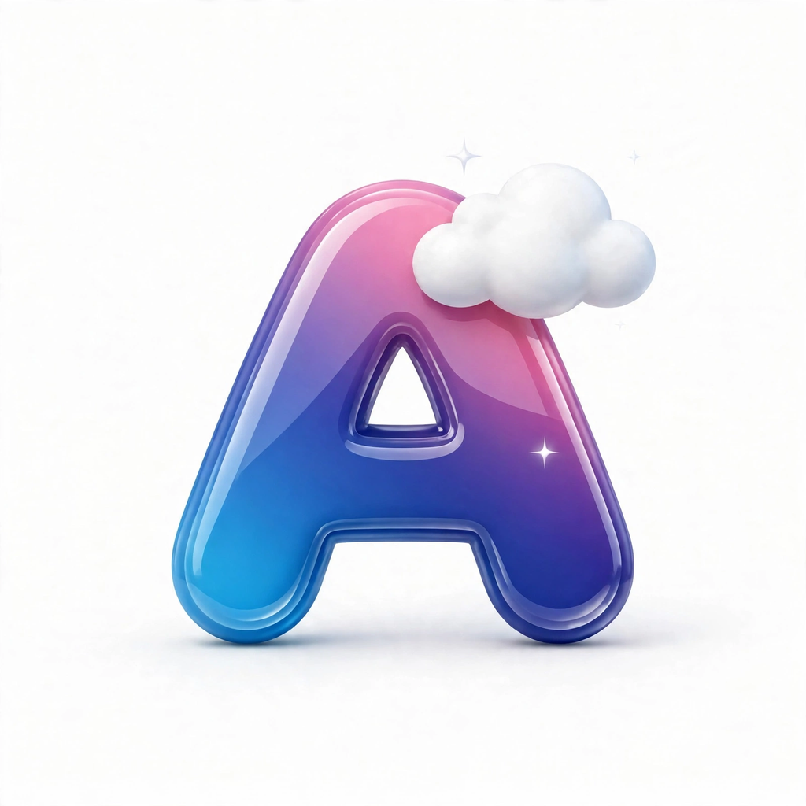

# AunuCore Creative Network

**Independent creative studio from Indonesia — building where AI, software, music, and animation meet.**

[Website](https://ai.aunuhost.bond) · [Patreon](https://www.patreon.com/AunuCore) · [X — @AunuHost](https://x.com/AunuHost)

---

## What we build

### AunuCore AI Gateway — our flagship
One API for **190+ AI models** at [ai.aunuhost.bond](https://ai.aunuhost.bond): an OpenAI-compatible gateway with a built-in playground, REST API (311 endpoints), and MCP tool support for developers and creators.

### AunuBaileys
Our open-source WhatsApp automation library for Node.js — a clean, transparent competitor to upstream Baileys, with StickerPack & album messages, rich-message builders, and a built-in anti-ban layer.
- npm: [`aunubaileys`](https://www.npmjs.com/package/aunubaileys)
- Docs: [docsjs.aunucore.eu.cc](https://docsjs.aunucore.eu.cc)
- Repo: [AunuBaileys-lib](https://github.com/AunuCore/AunuBaileys-lib)

### More from the network
- **Minecraft plugins** and game content
- **AI Automation SaaS** — GitHub Actions AI automation as a subscription service
- **Original music & animation** under the AunuCore banner

## Support us

Everything here is built by a small team with a simple rule: powerful tools should be accessible to everyone, not just big companies.

- Become a patron: **[patreon.com/AunuCore](https://www.patreon.com/AunuCore)**
- Sponsor a repository through the **Sponsor** button

## Team

**AunuXdev** (Owner & Founder) · **Azarr** (Developer) · **Hairi Haslet** (Marketing) · **Kevin** (Tester) · **NovastructMusic** (Music Artist & Producer)

*Thank you for being part of the network.* 🖤

